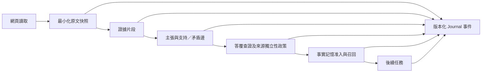

# 靈犀 LingXi：GitHub 專案對照與架構優化企劃書

> 版本：提案 v1 · 查核日期：2026-10-11 · 狀態：P0–P4 已獲准並實施；實測紀錄見 [08](08-v0.4-執行與回測紀錄.md)
> 本提案原以本機 `feature-new-version` 分支的 `0ce7590`、當時程式碼及 GitHub 專案公開內容為依據；提案當時只做靜態審閱，實施與回測結果另記於 08。

## 1. 決策摘要

靈犀已具備自己的瀏覽器感知、動作後驗證、發現板、答覆查證、長期記憶、黑匣子與受保護改進迴圈。下一次優化應優先補上**網頁原文 → 主張 → 答覆 → 長期記憶 → 後續行動**之間可追溯且可撤銷的關係，並以可重現的任務和同模型對照證明是否有用。

建議順序：

1. 校準現有文件、版本與基線，凍結比較方法。
2. 實作細粒度證據鏈和來源獨立性狀態。
3. 讓查證結果控制事實記憶的寫入、召回、過期和撤銷。
4. 用靈犀舊版／新版做消融回測，再對可比的 GitHub 代理做同條件比較。
5. 只有主方案通過驗收，再評估語義動作契約與記憶效益歸因。

本企劃不以「首次發明查證、記憶圖或提示注入評測」作為貢獻主張。可檢驗的貢獻是跨執行證據生命週期、改版撤銷與有意義的效果量測。

## 2. 目前系統與證據邊界

| 能力 | 目前實作 | 可直接確認的限制或待驗證問題 |
| --- | --- | --- |
| 核心與瀏覽器 | `Kernel`、`RunContext`、Playwright 感知及動作後驗證；跨分頁快照已有實作 | 尚缺一套針對頁面改版後「任務語義是否完成」的獨立判定；現有動作驗證不等於任務完成 |
| 資訊提取 | [`skills/web.py`](../lingxi/skills/web.py) 的 `web_read` 以模型提取 `facts`、`corroborates`、`contradicts`，直接更新發現板 | 僅儲存顯示用的來源網址，沒有原文片段與位置；`source = clip(page.url, 80)` 使完整網址無法由該欄位還原 |
| 多來源判斷 | [`kernel/boards.py`](../lingxi/kernel/boards.py) 以來源數標示多方印證；[`kernel/loop.py`](../lingxi/kernel/loop.py) 優先搜尋不同網域並檢查數字 | 不同網域可能轉載同一原始內容；相同數字可能屬於不同對象、單位或生效時間。這是邏輯風險，尚未量測發生率 |
| 查證 | [`kernel/verify.py`](../lingxi/kernel/verify.py) 拆解答覆並退回無據或矛盾的陳述 | `passed` 由「沒有 problems」決定；無證據、查證呼叫失敗或輸出無法解析時回傳 `skipped`，因此需把「未查證」與「已通過」分開 |
| 記憶 | [`memory/lightmem.py`](../lingxi/memory/lightmem.py) 可將成功／部分成功執行中的非衝突發現寫入語義記憶 | 單一來源事實也可能寫入；目前未以可驗證原文片段作為准入條件。指令式內容已有啟發式過濾，仍需要跨執行污染回測 |
| 觀測與評測 | [`journal/recorder.py`](../lingxi/journal/recorder.py) 有追加式 `events.jsonl`；[`evolve/e2e.py`](../lingxi/evolve/e2e.py) 有固定劇本受保護評測 | 既有 e2e 劇本關閉記憶與查證，無法直接驗證本企劃。事件缺少上述節點的穩定關聯 ID |

[`06 · v0.3 執行紀錄`](06-v0.3-執行紀錄.md) 記載：W1 的 12 題兩組各三次、共 72 次均為 ScriptedLLM 離線乾跑；W2 的 4 題 e2e 也是固定離線任務。這些結果證明管線可重現，尚不能證明真實模型的成功率、記憶增益或成本優勢。現有 [`pyproject.toml`](../pyproject.toml) 仍標 `0.2.0`，而執行文件稱 v0.3；[`README`](../README.md) 的速度與成本數字和 [`03 · GitHub 差異化分析`](03-GitHub差異化分析.md) 的部分測試路徑需重新標示適用版本及「合成／實測」性質。上述屬文件一致性問題，不代表功能故障。

## 3. 與 GitHub 現有專案的逐項對照

查核範圍為各專案截至 2026-10-11 的公開 README／相關原始碼。表中「未見」只代表本次查核的公開範圍，不能推論整個專案完全沒有該功能。瀏覽器代理、研究代理、記憶元件和評測框架用途不同，不能混成單一排行榜。

| 專案與角色 | GitHub 專案目前公開的做法 | 靈犀目前的差別 | 可採納的做法與邊界 |
| --- | --- | --- | --- |
| [FoundationAgents/OpenManus](https://github.com/FoundationAgents/OpenManus)；同源通用代理 | `Manus → ToolCallAgent → ReActAgent → BaseAgent` 繼承鏈；目前 README 與 [`manus.py`](https://github.com/FoundationAgents/OpenManus/blob/main/app/agent/manus.py) 說明預設透過 MCP 啟動 Browser Use CLI 3.0 | 靈犀採 `Kernel`＋鉤子及自有 Playwright 感知；既有差異文件所述的上游瀏覽器版本已過時 | 對照通用任務與工具擴充能力；不為了追上上游而重寫成同一繼承鏈 |
| [browser-use/browser-use](https://github.com/browser-use/browser-use)；瀏覽器代理 | 提供本機／雲端瀏覽器、Python 函式庫、CLI、自訂工具、結構化輸出及其 benchmark | 靈犀較專注發現板、答覆查證和長期記憶的閉環；瀏覽器操作本身不是可宣稱獨有的優勢 | 借鏡工具契約及穩定操作；保留自有感知層，以同模型和同站點對跑檢查是否真的較可靠 |
| [GPT Researcher](https://github.com/assafelovic/gpt-researcher)；研究報告代理 | 將問題拆成研究子題，蒐集、篩選並追蹤來源，生成帶引用的報告；支援深入研究流程 | 靈犀的調研融在通用瀏覽器主迴圈，已有 F 編號發現板，但引用尚未錨定至原文片段 | 借鏡逐主張引用和研究任務分解；僅在研究題對照報告品質，訂票等互動任務不拿來比較 |
| [LightMem／FluxMem](https://github.com/zjunlp/LightMem) 與 [A-MEM](https://github.com/agiresearch/A-mem)；記憶元件 | LightMem 倉庫提供記憶存取與基準，FluxMem 描述異質記憶圖；A-MEM 支援動態記憶連結及更新 | 靈犀已有受其啟發的壓縮、分層記憶與技能蒸餾；目前沒有充分證據宣稱重現它們的論文結果 | 保留靈犀特有的網站操作經驗，加入來源證明、時效及撤銷；記憶元件只做相同任務的單獨對照 |
| [BrowserGym](https://github.com/ServiceNow/BrowserGym)／[AgentLab](https://github.com/ServiceNow/AgentLab)；評測基建 | 提供可擴充的瀏覽器任務環境與跨 benchmark 評測 | 靈犀已有本地夾具與受保護劇本，但不足以支持跨代理效益宣稱 | 先使用本地動態任務，之後以選配 adapter 接外部 benchmark；避免核心依賴大型評測框架 |
| [AgentDojo](https://github.com/ethz-spylab/agentdojo)；安全評測 | 將正常任務、攻擊與防禦組成可運行的提示注入基準 | 靈犀有記憶寫入啟發式防護，尚無「惡意頁面 → 後續任務」的獨立評測 | 借鏡攻擊與正常任務分開計分；量測實際寫入和實際動作，避免只依模型提議判成功 |

**關鍵比較結論**：靈犀已有相當完整的垂直整合。純粹增加多代理、更多記憶節點或更大的瀏覽器工具集，容易與現成專案重疊且增加維護面積。最值得投資的缺口是：證據被引用、持久化及更新時，可信狀態是否仍然正確。

## 4. 候選優化方案與選擇

| 方案 | 預期貢獻 | 工程成本／風險 | 建議 |
| --- | --- | --- | --- |
| A. 可撤銷證據鏈：原文片段、主張、來源關係、答覆和記憶共用 ID | 能降低錯誤印證及過期記憶，並提供可回放的因果線索；與現有架構相容 | 中等；需處理頁面轉換、敏感資料、舊事件相容性 | **優先執行** |
| B. 語義動作契約：動作前定義預期頁面狀態，動作後核對任務條件 | 可處理「DOM 變了，但任務未完成」 | 中等；各網站與任務的後置條件難通用化 | A 通過後，以高價值場景試點 |
| C. 記憶效益歸因：同任務記憶開／關對照並記錄召回節點如何影響結果 | 能證明記憶帶來淨效益及找出有害記憶 | 高；真實模型波動及執行費用較大 | 評測設計先完成；正式實驗待模型與預算確定 |

方案 A 的新意在**跨階段整合及撤銷傳播**，並非任何單一演算法的首創。若只完成資料結構而無法在回測中降低錯誤接受率，則不宣稱有實際貢獻。

## 5. 方案 A 的架構設計

### 5.1 資料契約

- `SourceSnapshot`：`snapshot_id`、`run_id`、完整 URL、讀取時間、原始文字雜湊、可選的最小化原文附件與頁面轉換資訊。來源 ID 不以截短網址產生。
- `EvidenceSpan`：`span_id`、`snapshot_id`、原始文字的起訖位置、原文短引及雜湊。顯示用繁體字形另存；不得用字形轉換後的索引假裝是原文位置。
- `Claim`：`claim_id`、陳述、可解析時的對象／屬性／值／單位／生效時間、狀態。解析不出結構時仍可保留自由文字，但不能假裝已完成數值核對。
- `EvidenceEdge`：主張與片段的「支持／矛盾／僅提及」關係、核對方法、來源群組及獨立性狀態。
- `MemoryReference`：記憶節點關聯的 `claim_id`、准入版本、過期／撤銷狀態與後續使用事件。

片段位置相對於**實際保留的原文摘錄**；擷取當下需先在完整頁面文字中完成存在性核對，並記錄核對結果。只保存片段與整頁雜湊時，事後仍無法單靠雜湊重建整頁，報告須明說這項重播限制；需要完整重現的本地情境則可保存完整夾具快照。

### 5.2 判定規則

1. 模型只提出片段、主張和關係；程式先檢查引文確實存在於該次快照，再核對對象、數值、單位與時間。字面出現不等於支持。
2. 兩個不同網址不自動等於獨立來源。先比對 canonical URL、發布者及高度相似的內容；無法判斷時標為「獨立性未知」。不同網域只是搜尋候選條件。
3. 區分 `single_supported`、`independently_supported`、`conflicted`、`unverified`、`stale`。這些是**證據狀態**，不是保證陳述為真。
4. 查證員未回應或沒有足夠證據時明確給 `unverified`。依任務風險決定是要求補查、附警示交付，還是擋下持久化；通用任務不一律中止。
5. 網頁事實的長期記憶須帶可用的證據鏈；站點操作經驗與事實記憶分開。來源改版、撤銷或到期時，關聯記憶降級並在下一次召回時可見。
6. 以現有 `events.jsonl` 增加可選事件與 schema 版本，不破壞舊紀錄與 F 編號。預設只保存完成查證所需的短片段，避免把整頁敏感內容長期寫進記憶。

### 5.3 預計修改邊界

新增 `lingxi/evidence/` 放資料契約及政策；在 `skills/web.py` 產生證據候選，在 `kernel/boards.py`、`kernel/verify.py`、`kernel/loop.py` 決定狀態，在 `memory/` 做准入和撤銷，在 `journal/` 做事件關聯與回放。設定採預設關閉或相容模式啟用，先讓舊任務維持可用。避免以另一套重型圖資料庫取代現有記憶圖。

## 6. 實施里程碑與決策門檻

| 階段 | 交付物 | 結束條件 |
| --- | --- | --- |
| P0：基線校準 | 現行功能清單、固定 commit、原始案例與比較協議；修正文件的版本、歷史測試路徑及合成數字註記 | 讀者能分辨已跑過的離線結果與尚未跑的真實模型結果 |
| P1：證據資料層 | schema、最小化原文片段、事件版本與舊紀錄讀取 | 每個新主張可追到可核對原文；舊 run 仍可回放 |
| P2：查證政策 | 實際片段核對、來源獨立性狀態、未查證狀態與風險分流 | 轉載、對象錯置、同數字不同日期不得升為獨立印證 |
| P3：記憶生命週期 | 寫入准入、召回標記、過期及撤銷傳播 | 失效事實不再以可信記憶影響新任務；撤銷有 Journal 軌跡 |
| P4：回測與對照 | 逐案例 JSONL、回放、靜態架構比較、靈犀消融報告；必要時接外部 benchmark | 依第 7 節共同指標報告改善與退步；未過門檻不將新政策設成預設 |
| P5：真實模型試點 | 同模型、同任務、同預算的成對執行及人工抽查 | 模型／提供者／費用上限確定後才開始；合成結果不得當成真實成效 |

每階段以獨立提交記錄變更；若新機制退步，可關閉設定回到舊路徑，資料 schema 則保留向後讀取能力。P4 前不宣稱效益已提升。

**可直接拆成工作項的交付清單**：

| 工作項 | 相依 | 要交出的具體成果 |
| --- | --- | --- |
| T1 文件與基線盤點 | 無 | 版本／數字／路徑對照表、鎖定案例與比較協議 |
| T2 證據資料契約 | T1 | 可序列化 schema、原文片段擷取、事件版本、舊事件讀取策略 |
| T3 網頁與發現板接線 | T2 | `web_read` 產生可核對片段；發現保留原本 F 編號並連至主張 ID |
| T4 查證政策 | T3 | 來源獨立性、數值／對象／時間核對及未查證狀態；清楚呈現在答覆摘要 |
| T5 記憶生命週期 | T4 | 事實寫入門檻、過期／撤銷事件、召回時的可信狀態 |
| T6 回測與比較報告 | T1–T5 | 逐案例輸出、獨立判分、消融表、與可比代理的同條件結果及失敗案例 |

以上工作項只涉及既有模組的明確接點及一個新的 `lingxi/evidence/` 包；P4 如需 BrowserGym adapter，應列為可選依賴，而非為了比較先改寫靈犀核心。

## 7. 比較實驗與驗收設計

### 7.1 任務與對手

- **完整代理比較**：靈犀舊版／新版、OpenManus、browser-use 使用同一批本地瀏覽器任務。研究報告子集可另加入 GPT Researcher。若某系統不支援任務要求，列為不適用，不計入失敗率。
- **元件比較**：LightMem／A-MEM 用於記憶檢索或更新子任務；BrowserGym／AgentLab 和 AgentDojo 用於評測方法或選配 adapter，不把它們當代理計成功率。
- **靈犀消融**：舊版、僅片段核對、再加來源獨立性、再加記憶准入／撤銷、完整方案。先把這組完成，再解讀跨專案差異。

### 7.2 至少覆蓋的情境

1. 同數字、不同對象／單位／年份。
2. 兩個網域轉載同一原始內容。
3. 規則或價格跨次執行改版，舊記憶需降級。
4. 真正獨立來源支持同一主張，檢查誤擋率。
5. 查證員逾時、輸出無法解析或頁面局部載入。
6. 網頁中的指令式文字企圖污染答覆及下一次任務的記憶。
7. 多分頁、頁面重新整理及 DOM 變動後的來源關聯。

本地情境以網站可觀測狀態及預先定義的正解判定，不能由被評代理自行宣稱成功。保留現有 12 題離線對照和 4 題受保護任務作回歸，但因後者關閉記憶和查證，須另增針對本方案的情境。根據先前清理要求，不恢復 `tests/` 原始碼目錄；保留可重跑的正式回測入口、必要情境資料和逐案例結果，清掉一次性驗證檔與暫存產物。

### 7.3 指標與門檻

| 指標 | 判定方式 | 首輪門檻／處置 |
| --- | --- | --- |
| 片段可追溯率 | 標為有據的主張是否能找到同次快照的原文片段 | 在離線情境中達 100%；否則不得上線 |
| 錯誤多方印證率 | 轉載、不同對象／時間的主張被錯升的比例 | 對預先設計的反例須為 0；擴大樣本後再估計真實率 |
| 過期／撤銷傳播 | 改版後舊記憶是否仍被當成有效事實召回 | 預先設計案例須全部正確降級並留下事件 |
| 正常任務成功率 | 獨立 oracle 判定；同模型、同限制、逐題配對 | 不應為安全機制付出無法解釋的退步；先報逐題差異與不確定性，再定是否可預設啟用 |
| 成本與延遲 | 呼叫數、供應商實際 token、牆鐘時間、查證輪數 | 與成功率及錯誤率同表列出；合成 token 單列，不能換算實際費用 |
| 注入後果 | 惡意內容是否實際寫入可信記憶、被召回或觸發後續動作 | 分別計提議、已寫入及實際動作；不可把攔截提議當成任務成功 |

正式實驗的任務清單、重複次數、模型與費用上限在執行前鎖定。外部代理盡量使用相同模型、瀏覽器、時間和 token 預算；工具能力、版本及失敗原因一併報告。初期樣本只支持工程決策，不支持廣泛的統計優越宣稱。

## 8. 風險、取捨與後續審批

| 風險 | 預先處理 |
| --- | --- |
| 網頁原文可能含私人資料 | 只保存相關短片段與雜湊，設定保存期限；不將整頁內容直接放進長期記憶 |
| 自動判定來源「獨立」可能出錯 | 不確定時維持未知，不自動升級；在報告列出無法判定案例 |
| 查證過嚴使正常任務失敗 | 用任務風險分流，並以正常任務成功率及誤擋率檢查 |
| 外部代理版本或服務快速變更 | 記錄比較當天的 commit／套件版本、模型、設定與適用任務；無法復現時不作優劣結論 |
| 文件、程式版本與展示數字不同步 | P0 先做證據盤點，再調整 README、文件索引及套件版號 |

**執行範圍**：P0–P4 的本地實施結果見 08；P5 的真實模型／公開站點試點仍需先確定模型、任務、費用和安全邊界。此企劃本身不構成「效果已改善」的證據。
